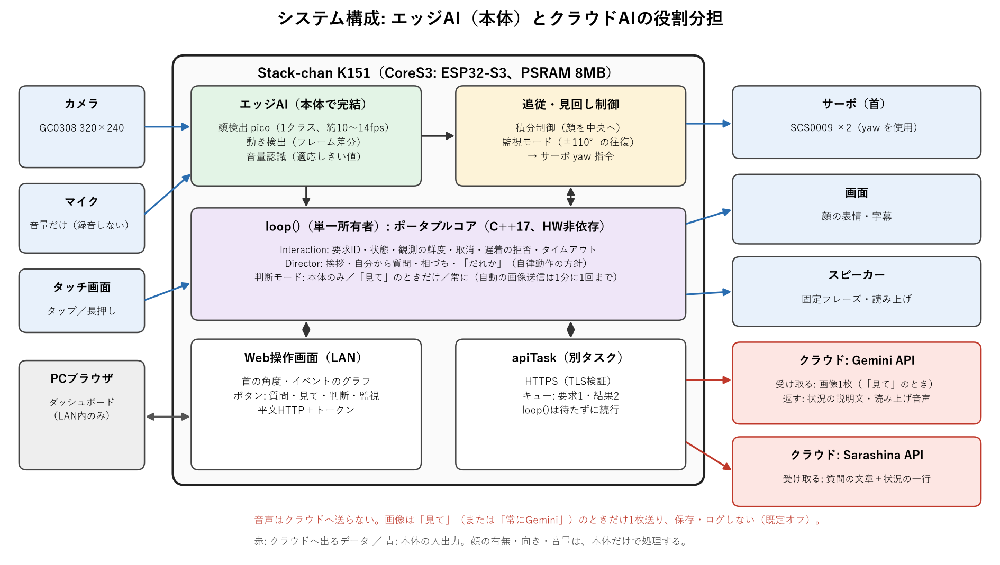
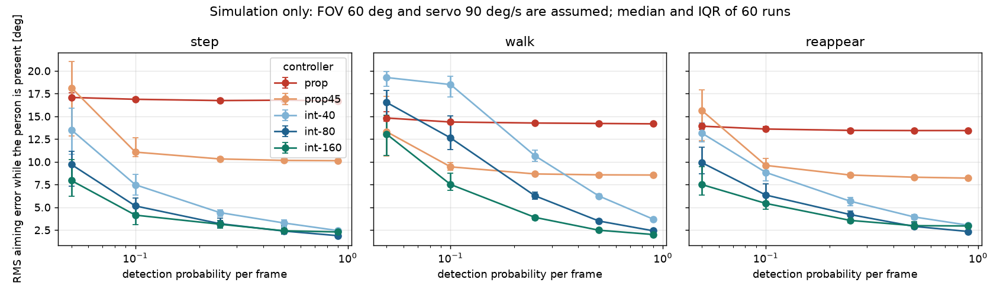

# Stack-chan Responsive AI

**追従制御・エッジAI（顔）・クラウドLLM（Sarashina/Gemini）を組み合わせた、小型ロボットの環境認識と応答制御**

M5Stack Stack-chan K151 に、本体上の顔検出と首の追従制御（エッジAI）、クラウドのLLM/VLM（Sarashina・Gemini）を、役割分担させたデモ。本体で分かること（顔の有無・向き・音量）は本体だけで処理し、分からないこと（何をしているか・何を持っているか）だけを、クラウドへ聞く。回答を待つ間も、追従・相づち・タッチ反応を止めない。通常動作は、本体とWi-Fiとクラウドだけで完結する（PC側のプロキシは使わない）。

**English summary.** A Stack-chan K151 (ESP32-S3) robot that splits perception between the edge and the cloud: face detection (pico), motion and loudness sensing run on the board and drive a closed-loop head tracking controller; only what the board cannot tell (what is happening, what the person holds) is sent as a single camera frame to a cloud VLM (Gemini), and text questions go to an LLM (Sarashina). Images are sent only on request (off by default). MIT licensed. Demo video and report: see links below.

> 状態（2026-10-30）: 実機で動く作業版。評価実験は未実施で、論文は作業草稿。確認済みと未確認は[「確認状況」](#確認状況)に分けて書く。

- デモ動画: （撮影後にYouTubeのURLを追記）
- 説明資料: [docs/SUBMISSION.md](docs/SUBMISSION.md)（実装と計画の区別、実機の記録、限界）
- 動画の台本: [docs/DEMO.md](docs/DEMO.md)　構成の詳細: [docs/ARCHITECTURE.md](docs/ARCHITECTURE.md)　シミュレーション: [docs/sim](docs/sim/README.md)

## 何ができるか

- **見る（本体）**: 本体カメラ（320×240）の画像から、本体上で顔検出（pico）または画像の変動（フレーム差分）を行い、首（yaw）を向ける。方式はWebから切り替えられる。
- **探す（監視モード）**: 誰もいないとき、首を左右±110°まで振って人を探す。見つけたら、追従に切り替える。
- **考える（クラウド）**: 顔を見つけて約3秒たつと、自分からSarashina APIへ質問する（Webやタッチでも質問できる）。回答は字幕で出す。
- **見て（クラウドVLM）**: 「見て」で、カメラ1枚をGeminiへ送り、状況の説明文を字幕と声で返す。送るかどうかは「判断」ボタンで選ぶ（既定は送らない）。
- **待つ間も止まらない**: 回答を待つ間も、顔追従・表情・タッチ反応・「えーっと」の相づちを続ける。回答が遅れて届いても、キャンセル済みや古い要求なら捨てる。
- **声と音**: 固定フレーズを、本体のスピーカーで話す。マイクは音量だけを見て、大きな音に反応する（録音・保存・送信はしない）。
- **操作画面**: 同じLAN内のブラウザで、首の角度の推移、回答待ちの時間帯、イベント、カメラ映像と検出枠を見られる。本体の画面は顔と字幕だけにしている。

## 構成



詳細は[docs/ARCHITECTURE.md](docs/ARCHITECTURE.md)。

### SWスタック

| 層 | 使っているもの |
|---|---|
| ハードウェア | M5Stack Stack-chan K151（CoreS3、ESP32-S3、フラッシュ16MB、PSRAM 8MB、GC0308カメラ、タッチ画面、スピーカー、マイク、SCS0009サーボ×2） |
| ビルド | arduino-cli 1.5.1、ESP32 Arduinoコア 3.3.11（FreeRTOS）、FQBN `esp32:esp32:m5stack_cores3` |
| 本体ライブラリ | M5StackChan 1.1.1（BSP、サーボ）、M5Unified 0.2.28、M5GFX 0.2.35、M5CoreS3 1.0.1（カメラ）、ArduinoJson 7.4.3、WebServer / ESPmDNS / HTTPClient / WiFiClientSecure（コア同梱） |
| 顔検出 | pico（Nenad Markus、MIT）を`firmware/libraries/PicoRnt`に同梱。正面顔のみ検出できる |
| ポータブルコア | `include/interaction.hpp`（要求ID・鮮度・状態・キャンセル）、`include/director.hpp`（挨拶・質問・相づちの方針）。C++17、ESP-IDF/Arduino/ハード非依存、ホストテスト済み |
| クラウド | Sarashina API（`sarashina3-nano`、HTTPS、Amazon Root CA 1を固定して検証）。任意でGemini API（画像1枚の解釈`gemini-3.5-flash-lite`、回答の読み上げ`gemini-3.8-flash-tts`）。Geminiのキーがなくても、文字とSarashinaだけで動く |
| 音声 | Open JTalk + HTS Voice "Mei"（CC BY 3.0）で事前に合成した固定フレーズ。表示は[THIRD_PARTY_NOTICES.md](THIRD_PARTY_NOTICES.md) |
| PC側の道具（開発・評価のみ） | Python（秘密情報・音声の生成、実機確認、シミュレーション）、g++（ホストテスト）。デモの動作には使わない |

## 動かす

前提: Windows/Linux/macOS、arduino-cli、ESP32コア 3.3.11、上の表のライブラリ、Python 3、K151（USB接続）。

```powershell
# 1. 秘密情報（git管理外）を環境変数から生成。キーをコミットしない。
#    SARASHINA_API_KEY, STACKCHAN_WIFI_SSID, STACKCHAN_WIFI_PASS（任意: GEMINI_API_KEY。画像の解釈と読み上げ用）
powershell -NoProfile -File tools/gen_secrets.ps1
# 2. 固定フレーズの音声を生成（任意。なければ無音で動く）
pip install pyopenjtalk-plus numpy
python tools/gen_voice.py
# 3. ビルドして書き込み（Windowsは長いパスを避けるため短いビルド先を使う）
arduino-cli compile --fqbn esp32:esp32:m5stack_cores3 --build-path C:\scb6 --libraries firmware\libraries `
  --build-property "compiler.cpp.extra_flags=-I<このリポジトリ>/include" firmware\answer_demo
arduino-cli upload -p COM3 --fqbn esp32:esp32:m5stack_cores3 --build-path C:\scb6 firmware\answer_demo
```

起動するとシリアル（115200）に`web http://<IP>/?t=<トークン>`が出る。同じLANのブラウザで開くと操作画面になる（`stackchan.local`も使える）。通信は平文のHTTPなので、信頼できるLANだけで使う。

操作: タップで反応、約0.9秒の長押しで中止・黙らせる。Webでは、質問、「見て」、中止、自律・消音・読み上げ・マイク・カメラ配信の切り替え、追従方式（顔検出 / 動き / 顔→動き）、判断（本体のみ / 「見て」のときだけGemini / 常にGemini）の切り替えができる。**画像は、判断をオンにして「見て」（または常にGemini）のときだけ、1枚をGeminiへ送る。既定はオフ。**

## 確認状況

**ホストテスト**（ポリシーの意味論だけ。実機のタイミング・AI・通信は証明しない）:

```sh
g++ -std=c++17 -Wall -Wextra -Werror -pedantic -Iinclude tests/host.cpp -o /tmp/stackchan-host && /tmp/stackchan-host
```

**実機（K151、COM3、2026-10-27〜29）**。根拠はシリアルログとHANDOFF.mdの記録:

| 項目 | 状況 |
|---|---|
| 画面・タッチ・首（yaw ±15°） | 確認済み（目視） |
| カメラ・顔検出・首の向き | 動作を確認。検出率は低い（顔が前にある間に約4〜50%、条件を統制していない記録）。評価値ではない |
| Sarashinaへの直接HTTPS | 確認済み（HTTP 200、約0.7秒、証明書を固定して検証） |
| キャンセル、遅着応答の拒否 | 確認済み（`tools/web_check.py`） |
| 通信失敗（誤キー・到達不能・ハング）と回復 | 確認済み（`tools/fault_check.py`、故障注入） |
| 固定フレーズの声 | 聞こえたとユーザーが報告 |
| 自律の挨拶→質問→回答待ちの間の追従と相づち→字幕、ダッシュボード、マイクの「音」の記録 | 確認済み（ダッシュボードの画像とシリアルログ、2026-10-30）。評価値ではない |
| 質問の繰り返し | 読み上げをオフにして31回、パニック0、API 526〜806 ms。読み上げを有効にすると、約25回で2〜3回再起動した（原因未特定、既定をオフにした） |
| 視覚（「見て」: カメラ1枚をGeminiへ送り、見えているものに触れた一言を返す） | 実機で動作確認（5回、応答5〜14秒でばらつく、1回は時間切れ）。既定オフ、有効にしたときだけ画像がクラウドへ出る |
| 動き検出モード、状況文つきの自律質問 | 実装済み。実機での効果は未確認 |
| 回答の読み上げ（Gemini TTS） | 実機で動作確認（音声が返り再生）。無料枠の回数制限（429）や通信失敗の回がある（字幕だけになる）。読み上げ末尾のノイズは、WAVのメタデータを再生していたのが原因で、修正済み（ユーザーの再確認は未了） |
| 再起動 | 読み上げ・「見て」を繰り返すと、本体が再起動することがある（ヒープ破損のassert、またはオーディオタスクの例外）。原因未特定。直近の4回の試験では0回 |
| 積分制御の実機での効果、Wi-Fi断からの回復 | 未検証 |

追従制御の比較は閉ループの**シミュレーションのみ**（[docs/sim](docs/sim/README.md)、`tools/track_sim.py`）。画角とサーボ速度は仮定で、実機の性能ではない。



## ディレクトリ

| 場所 | 内容 |
|---|---|
| `include/` | ポータブルコア（`interaction.hpp`、`director.hpp`） |
| `firmware/answer_demo/` | 本体のメインのスケッチ。ほかは段階的な動作確認用（minimal_ui、minimal_servo、camera_preview、face_detect、core_synthetic） |
| `firmware/libraries/PicoRnt/` | 同梱した顔検出器（MITライセンス、出典つき） |
| `tools/` | 秘密情報・音声の生成、実機確認（web_check、fault_check）、シミュレーション、ホスト実験 |
| `tests/`、`HOST_LAB.md` | ホストテストと、合成イベントの再生器・模擬API |
| `docs/` | 構成の詳細、シミュレーション |
| `paper/` | 論文草稿（日本語・英語。評価前の作業草稿） |

## 研究と範囲

問い: MCUの資源内で、クラウド応答を待ちながら身体反応と回答への切り替えをどう両立するか。顔追従そのものの新規性は主張しない（公式にもUiFlow2の顔追従サンプルがある）。主張の対象は、待機中の並行動作と、遅着・取消の扱いを含む調停の構成。ユーザー実験なしで、自然さ・愛着・待ち時間の短縮は主張しない。新規性は引き続き検討中。

M5Stack公式の[StackChan Issue #70](https://github.com/m5stack/StackChan/issues/70)（会話中の視覚追従）は、公式のAIエージェントのファームに顔検出を足すとメモリ不足になると報告している。本プロジェクトは別のファームで、音声認識などは含まない。

範囲（2026-10-29に見直し）: 固定フレーズ音声、LAN操作画面、自律動作、マイクの音量反応は範囲内。ROS・シミュレータを使う場合は開発・評価の道具に限る。

## 再開するとき（開発者向け）

1. [HANDOFF.md](HANDOFF.md): 現在地、実機の記録、次の一手。
2. [AGENTS.md](AGENTS.md): Claude/Codex等で共通に守る開発ルール。
3. 論文草稿: [日本語版](paper/manuscript-ja.md) / [英語版](paper/manuscript.md)。

GitHubを正本にする。作業終了時にコミットしてpushし、別PCではfetch/pullしてから再開する。force pushしない。

## 関連する取り組み（本課題の範囲外・参考）

本プロジェクトは、シミュレータではなく実機で動かすことにこだわった。以前の取り組み: Unitreeハッカソンでのシミュレーションと実機の動画（[1](https://youtube.com/shorts/tFogxTEo6s0)、[2](https://youtu.be/ACIyAEap29A)）、Robotic Academy「Follow Line by PID Control」でGazebo/ROSを動かした動画（[動画](https://youtu.be/QBND0NXNwVM)）。

## データとライセンス

APIキー、Wi-Fi情報、生画像、私的会話、機器ダンプ、講座PDFをコミットしない。MITライセンス（[LICENSE](LICENSE)）。第三者の成果物は[THIRD_PARTY_NOTICES.md](THIRD_PARTY_NOTICES.md)。
